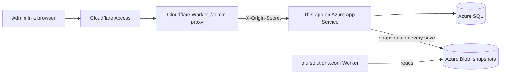

# GlurSolutions-DB-ASP.NET-Web-App

The admin back end for **[glursolutions.com](https://glursolutions.com)**. It is an ASP.NET Core Razor Pages app (.NET 10, Entity Framework Core, SQL Server) where I edit my portfolio's projects, skills, slideshows and notes. Every save writes to Azure SQL and then republishes a small set of JSON snapshot files to Azure Blob Storage. The public site reads only those snapshots and never touches the database.

The website itself lives in a separate repository: [Portfolio-Website](https://github.com/GLUR-DEV/Portfolio-Website).

## What it does

- **Edits site content** in a protected `/admin` area: projects, skills, slideshows, slides and the side-panel notes.
- **Publishes snapshots** to Blob Storage after every save (`technologies.json`, `projects.json` and one `project-<slug>.json` per published project).
- **Controls each project's buttons.** Every project has an optional **Go to live site** address and an optional **See the design notes** address. An empty box hides that button on the site.
- **Protects the admin** with four independent checks: Cloudflare Access, a secret header from the Cloudflare Worker, the app's own password login, and a locked-down session.
- **Keeps the database asleep** when nobody is editing, so Azure SQL serverless can auto-pause and visitors cause no database use at all.

## How it fits together



There are three paths through the system:

1. **Visitor:** browser, then the Cloudflare Worker, then the snapshot JSON in Blob Storage. This app is not involved.
2. **Admin:** browser, then Cloudflare Access sign-in, then the Worker (which adds `X-Origin-Secret` and `X-Client-Ip`), then this app, then Azure SQL.
3. **Publish:** admin save, then `SaveChangesAsync`, then `SnapshotService`, then Blob Storage.

### Why snapshots instead of a live API

- The site keeps working while the serverless database is paused or down.
- The database is never reachable from visitor traffic, which shrinks the attack surface.
- Reads are plain static files, so they are fast and cheap.
- Visitors cause no database use, which keeps the Azure free allowance safe.

## Features of the admin area

| Page | What it does |
| --- | --- |
| Projects | List of projects with status, counts and last update. Publish, unpublish and delete are immediate actions, not part of any Save. |
| Project editor, Details tab | Title, slug, short description, summary, card picture, **Buttons** (live site and design notes addresses), details panel (role, tools, timeframe), skills, sort order and published switch. |
| Slideshows and slides | The slideshows of a project (normally one *Process* and one *Improvement*) and their slides, each with a stage label, title, caption and picture. |
| Side-panel notes | The one-line *Feedback* and *What improved* notes shown beside the slideshows. |
| Skills | The skill pills and card tags. One Save for every row, with a Delete checkbox. A skill still used by a project cannot be deleted. |

Every list page saves as a batch: all rows are validated first, and nothing is saved if one is invalid. One database save and one snapshot refresh follow, and the page warns you about unsaved changes when you leave.

**Validation** matches the database limits and rejects bad input with a message. Slugs must be unique and use lower-case letters, numbers and single hyphens. Picture addresses must be a full `https://` address, a plain path on the site, or empty. Button addresses must be a full `https://` address or empty.

## Data model

```
Technology ──< ProjectTechnology >── Project ──< Slideshow ──< Slide
                                        └──< ProjectNote
```

| Table | Key fields and limits |
| --- | --- |
| Projects | Slug (unique, 80), Title (120), ShortDescription (300), Summary (1000), CoverImagePath, CoverAlt, Role, Tools, Timeframe, **LiveSiteUrl, DesignNotesUrl**, SortOrder, IsPublished, UpdatedUtc. Index on IsPublished and SortOrder. |
| Technologies | Key (unique, 40, lower-case words joined by hyphens), Label (60), SortOrder |
| ProjectTechnologies | Many-to-many link between Projects and Technologies |
| Slideshows | Kind (`Process` or `Improvement`, stored as text), Heading (120), SortOrder |
| Slides | StageLabel (60), Title (120), Caption (600), ImagePath, ImageAlt, SortOrder |
| ProjectNotes | Kind (`Feedback` or `Improved`), Heading (80), Body (400), SortOrder |

Rules:

- Deleting a project cascades to its slideshows, slides, notes and skill links.
- A skill that projects still use cannot be deleted (restricted).
- A project's `UpdatedUtc` refreshes whenever the project is added or changed.
- A slide with an empty `ImagePath` shows the placeholder picture on the site.
- Each slug becomes the project's address, for example `project-one`, shown at `projects.html?project=project-one`.

## Publishing flow

`RefreshSnapshotAsync()` runs right after `SaveChangesAsync()` on every page that changes content. `SnapshotService` then:

1. Reads the published data through `SiteDataBuilder`, in order of `SortOrder`.
2. Uploads `technologies.json`, `projects.json` and one `project-<slug>.json` per published project to the `snapshots` container, as `application/json` with `Cache-Control: no-cache`.
3. Deletes any `project-*` blob that no longer belongs to a published project, so unpublishing, renaming or deleting a project removes its saved copy.

If storage is unavailable the database change is already saved, the admin shows a warning, and the error is logged. The next save, or a manual rebuild, catches up. The storage client is created on first use, so a missing `Storage:ConnectionString` cannot break the admin pages at start-up.

**Manual rebuild:** `POST /internal/snapshot` with a header `X-Snapshot-Key` matching `Snapshot:Key` (compared in constant time). It returns `401` if the key is wrong or not configured, and `{ "refreshed": <timestamp> }` on success.

A project only gains newly added fields (such as the two button addresses) in its saved copy the next time it is saved.

## Security

Every request to `/Admin` passes these gates in order:

1. If `Admin:Username` and `Admin:PasswordHash` are not set, the app returns `404` (the admin does not exist).
2. **Development:** the request must come from this computer, otherwise `404`.
3. **Production:** `Admin:OriginSecret` must be set and `X-Origin-Secret` must match, otherwise `404`. Opening the `*.azurewebsites.net` address directly therefore shows nothing.
4. Security headers are added to the response.
5. A valid session is required, otherwise the request is redirected to `/Admin/Login`.

Cloudflare Access sits in front of `/admin` as an extra sign-in layer (configured in Cloudflare, not here). The app does not yet verify the Access token itself.

| Area | What is done |
| --- | --- |
| Passwords | PBKDF2-SHA256, 600,000 iterations, random 16-byte salt, stored as `v1.<iterations>.<salt>.<hash>`. Minimum 14 characters when the hash is created. Login input is capped at 256 characters. |
| Timing | A wrong username does the same work as a wrong password (dummy hash). Username and secret comparisons are constant time. |
| Errors | One generic message, "Wrong username or password". The typed username is never logged. |
| Brute force | 5 failed attempts per client IP gives a 15-minute lockout (`429`). A looser limit of 50 failures across all clients per 15 minutes slows distributed attacks. The lockout is held in memory, so it resets on restart. |
| Session cookie | `__Host-glur-admin`: HttpOnly, Secure, SameSite=Lax, path `/`, no Domain, session cookie. |
| Session lifetime | 30 minutes idle (sliding) and 8 hours absolute. |
| Invalidation | Changing the password hash or removing the account settings signs everyone out. |
| Visitor IP | `X-Client-Ip` or `CF-Connecting-IP` is trusted only when the origin secret is valid. |
| Forgery | Login, logout and every admin form carry antiforgery tokens. The antiforgery cookie `glur.af` is SameSite=Lax, Secure and HttpOnly. Logout is POST only. |
| Redirects | After login only paths starting `/Admin` on this site are accepted. |
| Response headers on `/Admin` | `Cache-Control: no-store`, `X-Frame-Options: DENY`, `X-Content-Type-Options: nosniff`, `Referrer-Policy: no-referrer`, `X-Robots-Tag: noindex, nofollow` and a Content-Security-Policy with no framing, forms posting to self only and no outside sources. |
| Discoverability | No links to `/Admin` on the public site, and it is not listed in `robots.txt`. |

## Endpoints

| Path | Purpose |
| --- | --- |
| `/Admin/...` | The admin pages (gated as above) |
| `GET /healthz` | Returns plain `ok` and never uses the database, so uptime checks and Azure's probe cannot wake it |
| `POST /internal/snapshot` | Manual snapshot rebuild (needs `X-Snapshot-Key`) |
| `/` | A small page pointing visitors to glursolutions.com |
| `/Error` | Generic error page used in production |

There is no public content API. The old `/api` endpoints were removed in v1.6.0 now that the site reads snapshots.

## Running it locally

You need the [.NET 10 SDK](https://dotnet.microsoft.com/download) and SQL Server LocalDB (or any SQL Server).

```bash
# 1. Create the admin password hash (prompts twice, at least 14 characters)
dotnet run -- hash-password

# 2. Store the admin account in user-secrets (the project already has a UserSecretsId)
dotnet user-secrets set "Admin:Username" "<your username>"
dotnet user-secrets set "Admin:PasswordHash" "<the hash from step 1>"

# 3. Optional: load the six placeholder projects into an empty database
dotnet user-secrets set "Seed:Enabled" "true"

# 4. Run (applies migrations to LocalDB on start-up)
dotnet run
```

Then open `https://localhost:7080/Admin`. In Development the admin only answers requests from your own computer. The local connection string is in `appsettings.Development.json` (LocalDB). To test publishing, also set `Storage:ConnectionString` in user-secrets. Without it, saves still work and the admin shows a "cached copy could not be updated" warning.

## Configuration

Never commit secrets. Use user-secrets locally and Azure App Service settings in production (a double underscore replaces the colon, for example `Admin__Username`).

| Setting | Purpose | Required |
| --- | --- | --- |
| `ConnectionStrings:DefaultConnection` | Azure SQL connection. Pooling is forced off and `ConnectTimeout` is raised to at least 60 seconds in code. | Always |
| `Seed:Enabled` | Load placeholder projects when the database is empty | Local only, default off |
| `Admin:Username` | Single admin account name | For `/Admin` to exist |
| `Admin:PasswordHash` | Output of `hash-password`, never the plain password | For `/Admin` to exist |
| `Admin:OriginSecret` | Long random string the Worker sends as `X-Origin-Secret`. Must match the Worker's `ADMIN_ORIGIN_SECRET`. | Production |
| `Storage:ConnectionString` | Blob Storage account for the `snapshots` container | For publishing |
| `Snapshot:Key` | Protects `POST /internal/snapshot` | For manual rebuilds |

## Database and migrations

- **Development:** the app applies migrations on start-up.
- **Production:** migrations are **never** applied on start-up. Run them deliberately from your own computer against the live database:

  ```bash
  dotnet ef database update --connection "<Azure SQL connection string>"
  ```

  Deploying a release that adds a migration does not change the database by itself. Until you run the command, pages that read the new columns fail with a database error. Your computer's IP may need to be allowed in the Azure SQL firewall first.
- **Create a migration** after changing an entity: `dotnet ef migrations add <Name>`, then commit the generated files in `Data/Migrations/`.
- **Seeding** is off by default and only runs when `Seed:Enabled` is true and no projects exist, so deleted placeholders never reappear.

Migrations so far: `InitialCreate` (the six tables) and `AddProjectLinks` (adds `LiveSiteUrl` and `DesignNotesUrl` to Projects).

## Azure SQL serverless behaviour

- Pooling is off, so nothing stays connected after a request and the database can auto-pause between admin sessions.
- `ConnectTimeout` is at least 60 seconds, so a database waking from a pause fails the first request less often. That first admin request can still be slow.
- `EnableRetryOnFailure` covers the single failure that can happen while the database wakes.

## Deployment

`.github/workflows/master_glursolutions.yml` builds and deploys to the **GlurSolutions** Azure App Service (Production slot):

- **Trigger:** a push to `master`, or run manually (`workflow_dispatch`).
- **Build job** (`windows-latest`, .NET 10): `dotnet build` and `dotnet publish` in Release, then uploads the `.net-app` artifact.
- **Deploy job:** signs in to Azure with a short-lived OIDC token (three `AZUREAPPSERVICE_*` GitHub secrets, no stored password), then deploys with `azure/webapps-deploy@v3`.

## Repository layout

```
Program.cs               Start-up, database, security and the /healthz and /internal/snapshot endpoints
Api/SiteDtos.cs          Shape of the JSON written to the snapshots
Data/                    AppDbContext, entities, seeder and EF Core migrations
Services/                SiteDataBuilder (reads published data) and SnapshotService (writes it to Blob Storage)
Security/                Admin gate, cookie login, password hashing, login throttle and the hash-password command
Pages/Admin/             The admin Razor Pages, shared layout, styles and project tabs
Pages/Index.cshtml       Small landing page for the back end's own address
wwwroot/                 Static files the app serves (copies of the site's CSS and JS)
Reference/               Static copies of the public site's pages, kept for reference
.github/workflows/       Azure deployment workflow
```

## Known limits

- The password is the only in-app check. Verifying the Cloudflare Access token inside the app is planned.
- The login lockout is held in memory. It resets on restart and is not shared between instances, which is fine for one App Service instance. Someone triggering the overall limit can lock you out for 15 minutes.
- The app signs in with the database admin login rather than a limited read/write SQL user.
- There is no audit log of admin changes and no automated tests yet.
- Picture addresses must be full `https://` URLs (for example Blob Storage). Uploaded files and relative paths will not appear on glursolutions.com.
- If a snapshot refresh fails, the site catches up on the next save or a manual `POST /internal/snapshot`.
